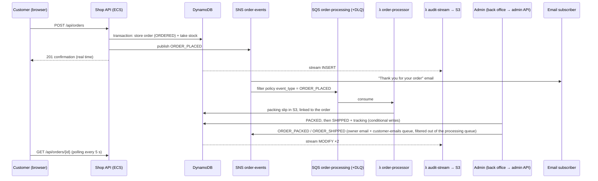

# FISA Shop — AWS Project 2026

Online vinyl record shop ("FISA Records") where customers browse a catalog,
place orders and get a real-time confirmation. Orders are recorded for audit
and trigger internal processing (packing slip). Shop staff use a separate
**back office** to add records (with cover images), restock, follow this
month's sales and move orders from *ordered* to *packed* to *shipped*.

One infrastructure, fully automated with Terraform and sized for the AWS Free
Tier, combining **containers on EC2 (ECS)** for the request/response API and
**Lambda** for event-driven work:

| Runs on | What | Why |
|---|---|---|
| **ECS on EC2** (Express, Node.js) | Shop API: catalog, place order, track order | Answers users, always on, horizontal scaling behind an ALB |
| **ECS on EC2** (Express, Node.js) | Admin API: products, stock, image uploads, orders, sales dashboard, team accounts | Separate service + IAM role, same cluster and ALB (path rule) |
| **Lambda** (Node.js) | Packing slips (SQS), customer emails via SES (SQS), audit trail (DynamoDB Stream) | Triggered by events, bursty, no idle cost |
| **S3 + CloudFront** | Storefront and back office (Vite), product images, packing slips | Static content at the edge, single HTTPS entry point |
| **Cognito** | Two user pools (free Lite tier): back-office sign-in (hosted login, `admins` / `owners` groups) and customer sign-in/up for the storefront (own page, Cognito API) | Managed users/passwords, kept apart so a customer can never reach the admin API |
| **DynamoDB** | Products and orders (+ stream, `by_month`, `by_customer` indexes) | Serverless, always-free 25 RCU/WCU |

Both APIs and the Lambdas use the same code for the order domain
(`backend/lib/`):

* order status changes are DynamoDB conditional writes
  (`ORDERED → PACKED → SHIPPED`, `CANCELLED` from `ORDERED`/`PACKED`), so two
  admins (or an admin and a Lambda) can never race an order into a wrong state;
* placing an order is a DynamoDB transaction that stores the order **and**
  takes the records out of stock (`409` when there is not enough), cancelling
  puts them back atomically;
* the back office owns the catalog once deployed: `data/catalog.json` only
  seeds the table (Terraform ignores later changes to those items).

```
.
├── frontend/                 # Vite storefront (calls /api/*, loads /images/*)
├── backoffice/               # Vite back office, own CloudFront address (calls /admin/api/*)
├── images/                   # Product images uploaded to the images S3 bucket
│   ├── covers/               #   album covers (one per product)
│   └── generate_covers.py    #   regenerates the placeholder SVG covers
├── data/catalog.json         # Product catalog (seeded into DynamoDB by Terraform)
├── backend/
│   ├── lib/                  #   shared order domain + AWS clients
│   ├── api/                  #   Express shop API (ECS service), Dockerfile in backend/
│   ├── admin/                #   Express admin API (2nd ECS service, Cognito tokens)
│   ├── functions/            #   Lambdas: order-processor, customer-notifier, audit-stream
│   ├── dev/                  #   local backend: DynamoDB Local + S3 stand-in (`npm run dev`)
│   └── test/                 #   tests against DynamoDB Local (SNS/S3/SES captured)
├── infra/                    # Single Terraform root module
│   ├── baseline.tf           #   budget alerts + CloudTrail
│   ├── network.tf            #   VPC, 2 public subnets
│   ├── alb.tf, ecs.tf, ecr.tf#   ALB, ECS cluster/capacity provider/services, image build
│   ├── cognito.tf            #   back-office user pool, hosted login, admins group
│   ├── lambda.tf             #   Lambda functions + triggers
│   ├── dynamodb.tf, messaging.tf, storage.tf, cdn.tf, monitoring.tf
├── tests/                    # test.sh (end to end), failover.sh
└── docs/                     # Architecture diagrams (overview + 4 sections, regenerate with generate_diagrams.py)
```

## Addresses and API

Each app has its own CloudFront address (both free, printed by Terraform):

| Output | App | Routes |
|---|---|---|
| `base_url` (`https://d111….cloudfront.net`) | Storefront | `/` site, `/images/*`, `/api/*` → shop API |
| `backoffice_url` (`https://d222….cloudfront.net`) | Back office | `/` site, `/images/*`, `/admin/api/*` → admin API |

The admin API is only routed through the back-office address. Own subdomains
(`shop.` / `admin.`) would need a domain name + ACM certificates (see the
alternatives at the end).

Storefront API:

| Method | Path                | Purpose                                   |
|--------|---------------------|-------------------------------------------|
| GET    | `/api/health`       | Which ECS task / AZ answered               |
| GET    | `/api/products`     | Catalog                                   |
| POST   | `/api/orders`       | Place an order (one or more products)     |
| GET    | `/api/orders/{id}`  | Order status + full history (audit)       |
| GET    | `/api/me/orders`    | My orders, newest first (customer token)  |
| POST   | `/api/me/orders/{id}/cancel` | Cancel my order while it is still `ORDERED` (restocks; `409` once packed) |
| GET    | `/images/{key}`     | Product image (CloudFront → images S3 bucket) |

Customers sign in or up on the storefront's own page (`#/signin`, `#/signup`; email
confirmation code, password reset; the browser calls the Cognito API directly,
no hosted login page; optional: guests can still order). `POST /api/orders` with a customer token
(`Authorization: Bearer <access token>`) attaches the order to the account
(`customer_id`, `by_customer` index); `/api/me/*` requires the token and only
ever returns or touches the caller's own orders.

Back-office API (`Authorization: Bearer <Cognito access token>`, `admins` group):

| Method | Path                               | Purpose |
|--------|------------------------------------|---------|
| GET    | `/admin/api/dashboard?month=YYYY-MM` | Revenue, orders, records sold, daily revenue, top records, low stock |
| GET/POST | `/admin/api/products`            | List / create records |
| PATCH  | `/admin/api/products/{id}`         | Edit a record (price, cover, …) |
| POST   | `/admin/api/products/{id}/stock`   | Add received stock (atomic `ADD`) |
| POST   | `/admin/api/uploads`               | Presigned S3 POST for a cover (JPG/PNG/WebP, ≤ 5 MB) |
| GET    | `/admin/api/orders?month=&status=` | Orders of a month (`by_month` index), newest first |
| GET    | `/admin/api/orders/{id}`           | Order + presigned link to its packing slip |
| POST   | `/admin/api/orders/{id}/status`    | `PACKED`, `SHIPPED` (+ tracking number) or `CANCELLED` (restocks) |

## Architecture

The full picture is [docs/architecture.svg](docs/architecture.svg); four
smaller diagrams each zoom in on one part of it:

| Diagram | Shows |
|---|---|
| [1 · web entry](docs/architecture-1-web.svg) | The two CloudFront distributions, the S3 buckets they serve and the path to the ALB |
| [2 · APIs and sign-in](docs/architecture-2-apis.svg) | ALB, shop-api and admin-api on ECS, the two Cognito user pools, what each API reads and writes |
| [3 · event-driven work](docs/architecture-3-events.svg) | SNS fan-out, the SQS queues and Lambdas (packing slip, customer emails) and the audit trail |
| [4 · build, monitoring and guardrails](docs/architecture-4-ops.svg) | Image build and deploy, CloudWatch alarms, CloudTrail and the cost budget |

```mermaid
flowchart LR
    U((Customers)) -->|HTTPS| CF[CloudFront<br/>storefront]
    A((Admins)) -->|HTTPS| CFA[CloudFront<br/>back office]
    A -->|hosted login| COG[Cognito user pool<br/>admins group]
    CF -->|/ OAC| S3W[(S3 website)]
    CFA -->|/ OAC| S3B[(S3 back office)]
    CF & CFA -->|/images/* OAC| S3I[(S3 images)]
    CF -->|/api/*| ALB[ALB<br/>CloudFront prefix list only]
    CFA -->|/admin/api/*| ALB
    subgraph VPC 10.10.0.0/16 — 2 AZs, public subnets
      ALB -->|default| T1[ECS shop-api ×2]
      ALB -->|/admin/api/*| T2[ECS admin-api]
      T1 & T2 -.- EC2[ECS capacity provider<br/>ASG 2× t3.micro, one per AZ]
    end
    ECR[(ECR)] -.->|image| T1 & T2
    T2 -.->|verify JWT| COG
    A -->|presigned POST| S3I
    T1 & T2 --> PT[(DynamoDB products)]
    T1 & T2 --> OT[(DynamoDB orders<br/>by_month index)]
    T1 & T2 -->|publish| SNS[SNS order-events]
    SNS --> SQS[SQS + DLQ] --> L1[λ order-processor] --> S3D[(S3 documents<br/>packing slips)]
    L1 --> OT
    SNS --> Mail[Email]
    OT -->|DynamoDB Stream| L2[λ audit-stream] --> S3A[(S3 audit<br/>versioned, 90 d)]
```

### Event flow



SNS message filtering keeps `ORDER_PACKED`, `ORDER_SHIPPED` and `ORDER_CANCELLED` events out of the processing queue,
failed messages are retried 3 times and then moved to a dead-letter queue
(which triggers a CloudWatch alarm).

* **High availability**: 2 container instances, one per AZ, each running one
  shop API task behind the ALB (health checks on `/api/health`, replaced
  automatically, deployment circuit breaker with rollback), so losing a task,
  an instance or an AZ keeps the shop up while ECS and the ASG replace it; the
  single admin API task is restarted on the other instance (the back office is
  internal, a short outage is acceptable); task auto scaling on CPU (60 %). DynamoDB, SQS,
  SNS, Lambda, S3 and CloudFront are multi-AZ or global by design.
  `-var asg_min_size=1` stays fully Free Tier but makes the instance a single
  point of failure (a few minutes of 502/503 while the ASG replaces it).
* **Streaming**: DynamoDB Streams → Lambda replaces Kafka/MSK at zero cost; the
  audit bucket is partitioned by date (`orders/dt=YYYY-MM-DD/…`) so it can be
  queried with Athena for reporting.
* **Security**: the back office needs a Cognito sign-in (hosted login,
  authorization code + PKCE, no self sign-up) and the admin API checks every
  access token (signature, expiry, client, `admins` group); covers are uploaded
  straight to S3 with presigned POSTs limited to 5 MB JPG/PNG/WebP (no SVG);
  packing slips stay private (5-minute presigned links); the ALB only accepts
  CloudFront (AWS managed prefix list) and container instances only accept the ALB; private S3 buckets behind
  CloudFront Origin Access Control; least-privilege IAM roles (one per Lambda,
  a task role for the API, separate from the instance and execution roles);
  IMDSv2 with hop limit 1 so containers cannot read the instance credentials;
  encrypted EBS, SQS, SNS; ECR image scanning; no SSH (Session Manager);
  CloudTrail on every API call.
* **Free Tier choices**: ECS on EC2 instead of Fargate (no Fargate free tier),
  no NAT Gateway (instances in public subnets, inbound locked to the ALB),
  provisioned DynamoDB capacity, Container Insights off, 7-day log retention.

## Prerequisites

* Terraform ≥ 1.6, AWS CLI v2, `jq`, `curl`
* Node.js ≥ 22 (frontend build, backend tests)
* Docker with `buildx` running (Terraform builds and pushes the API image to ECR)
* AWS credentials with permission to create the resources (`aws sts get-caller-identity`)
* Default region: `eu-west-3` (Paris) — override with `-var region=…`

## Deploy

```bash
# 1. Build the storefront and the back office (Terraform uploads both dist/)
cd frontend && npm ci && npm run build && cd ..
cd backoffice && npm ci && npm run build && cd ..

# 2. Deploy everything (~5–10 min, CloudFront is the longest step)
cp infra/terraform.tfvars.example infra/terraform.tfvars   # set your emails (notifications + first admin)
terraform -chdir=infra init
terraform -chdir=infra apply
terraform -chdir=infra output base_url
terraform -chdir=infra output backoffice_url
```

`terraform apply` stops with an explicit error if a `dist/` folder is missing.
With `admin_email` set, Cognito emails that admin a temporary password; sign in
at `backoffice_url` and choose a new password. That first admin is an **owner**:
the **Team** page invites more people (Cognito emails them a temporary password).
Two roles: **staff** use the back office (orders, products, dashboard); **owners**
also manage accounts (invite, change role, disable, remove). Roles are the
`admins` Cognito group (everyone) plus `owners`; owners can't change or remove
their own account, so one owner always remains.
Confirm the SNS subscription emails ("AWS Notification - Subscription
Confirmation") to receive order confirmations and alarms. After the first
apply, the container instance needs 2–3 minutes to join the cluster and start
the tasks; until then `/api/*` returns 502/503.

**Customer emails**: set `sender_email` in `terraform.tfvars` and click the verification
link SES sends to it. The `customer-notifier` Lambda then emails the customer when an
order is placed, packed, shipped (with tracking number) or cancelled. New SES accounts
are in sandbox mode and can only send to verified addresses: verify your test
customers' addresses, or request SES production access for real customers.
Without `sender_email` the feature is off.

## Develop

Everything runs locally with Docker, no AWS account needed:

```bash
cd backend && npm ci
npm test       # shop API, admin API and Lambdas against DynamoDB Local (Docker)
npm run dev    # both APIs on :8080 + DynamoDB Local + S3 stand-in, seeded from data/catalog.json

cd backoffice && npm ci && npm run dev                                # http://localhost:5174/ (local sign-in)
cd frontend && SHOP_BACKEND=http://localhost:8080 npm run dev         # storefront on the local backend
cd frontend && npm run dev                                            # or with its built-in mock API
```

## Test scenarios

Open `base_url` in a browser and place an order, then open `backoffice_url`
in another window: the order is under *To pack* with its packing slip; mark it
packed, then shipped, and watch the customer's timeline follow
(`Order placed → Packed → Shipped`). The dashboard shows the month's revenue and
the stock went down. The storefront footer shows which ECS task and AZ answered.

```bash
./tests/test.sh       # load balancing, catalog + image, order, packing slip, S3 audit trail, access control
ADMIN_EMAIL=you@example.com ADMIN_PASSWORD='…' ./tests/test.sh   # + back office: packed, shipped, dashboard
./tests/failover.sh   # stop an API task: the ALB keeps serving and ECS starts a replacement
```

Useful checks during the demo:

```bash
# Audit trail: one JSON document per order change
aws s3 ls s3://$(terraform -chdir=infra output -raw audit_bucket)/orders/ --recursive

# API logs (ECS) and processor logs (Lambda)
aws logs tail /ecs/fisa-shop/shop-api --follow
aws logs tail /ecs/fisa-shop/admin-api --follow
aws logs tail /aws/lambda/fisa-shop-order-processor --follow
```

CloudWatch dashboard: `terraform -chdir=infra output dashboard_url`.

## Cost and Free Tier

| Service | Usage | Free Tier coverage |
|---|---|---|
| EC2 t3.micro × 2 (ECS container instances, one per AZ) | ASG min 2 / max 2, 30 GB gp3 each, 1 public IPv4 each | 750 h/month, 30 GB EBS and 750 h of public IPv4 cover 1 instance; **the 2nd one is billed** (~15 USD/month for instance + disk + IP). `asg_min_size=1` stays free |
| ECS | cluster, 2 services (shop ×2, admin ×1 tasks), capacity provider | no charge on EC2 |
| ECR | 1 repository, last 5 images | 500 MB/month (12 months) |
| ALB | 1 ALB | 750 h + 15 LCU/month (12-month legacy Free Tier). **Its public IPv4 addresses are billed** (~0.005 USD/h each ≈ 0.25 USD/day) |
| Lambda | 2–3 functions, arm64 128 MB | 1 M requests + 400 000 GB-s/month (always free) |
| DynamoDB | 2 tables + 2 indexes × 5 RCU/WCU, Streams | 25 RCU/WCU + 25 GB + 2.5 M stream reads (always free) |
| Cognito | Lite tier, hosted login | 10 000 monthly active users free |
| CloudFront | 2 distributions (storefront, back office) | 1 TB + 10 M requests/month across all distributions (always free) |
| S3 | website, images, documents, audit, trail | 5 GB (12 months) |
| SNS / SQS | | 1 M publishes / 1 M requests (always free) |
| CloudWatch | 6–7 alarms, 1 dashboard, logs 7 days | 10 alarms + 3 dashboards + 5 GB logs |
| CloudTrail | 1 trail, management events | first copy free |
| Budgets | 1 budget | first 2 free |
| KMS | AWS managed keys only | no monthly key fee |

Accounts created after 15 July 2025 use the new Free Tier (credits up to
200 USD for 6 months) instead of the 12-month offers; the setup stays well
within those credits. **Destroy the stack after the demo**:

```bash
terraform -chdir=infra destroy
```

## Not implemented (cost) — proposed alternatives

| Need | Implemented (free) | Production alternative (paid) |
|---|---|---|
| Streaming | DynamoDB Streams → Lambda | Amazon MSK / MSK Serverless (Kafka) or Kinesis Data Streams → Firehose → S3 |
| Private container instances | public subnets + SG (inbound from ALB only) | private subnets + NAT Gateway or VPC endpoints |
| Database | DynamoDB provisioned 5 RCU/WCU | on-demand capacity, global tables, PITR backups |
| Custom domains + TLS CloudFront → ALB | one default `*.cloudfront.net` address per app, HTTP between CloudFront and ALB | domain + Route 53 hosted zone (~0.50 USD/month) + free ACM certificates: `shop.` / `admin.` subdomains |
| Edge protection | ALB reachable from CloudFront only | AWS WAF on CloudFront, Shield Advanced |
| Customer emails | SNS topic subscription | Amazon SES transactional emails per customer |
| Order workflow | admin actions + packing-slip Lambda | Step Functions (packing → shipping → invoicing) |
| Customer accounts | anonymous orders (Cognito for admins only) | Cognito customer pool: order history, self-service cancellation |
| Back-office sign-in hardening | password + Cognito Lite | Cognito Essentials/Plus: MFA, threat protection, custom domain |
| Container capacity | ECS on EC2 t3.micro (capacity provider) | ECS Fargate (no instances to manage) or EKS |
