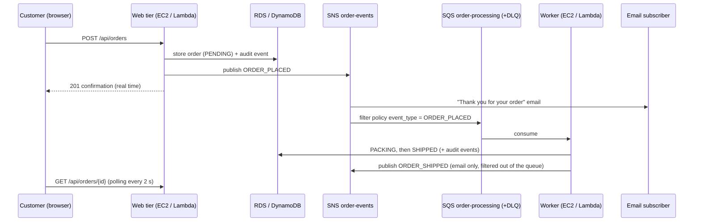
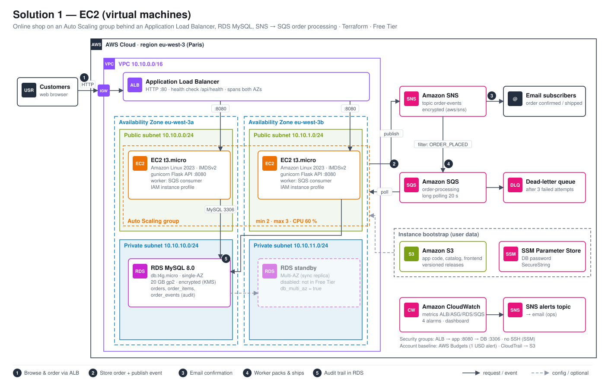
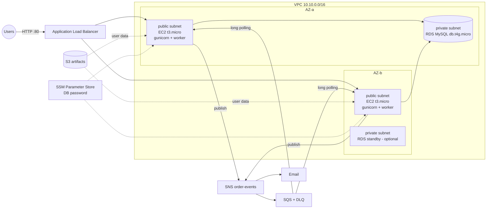
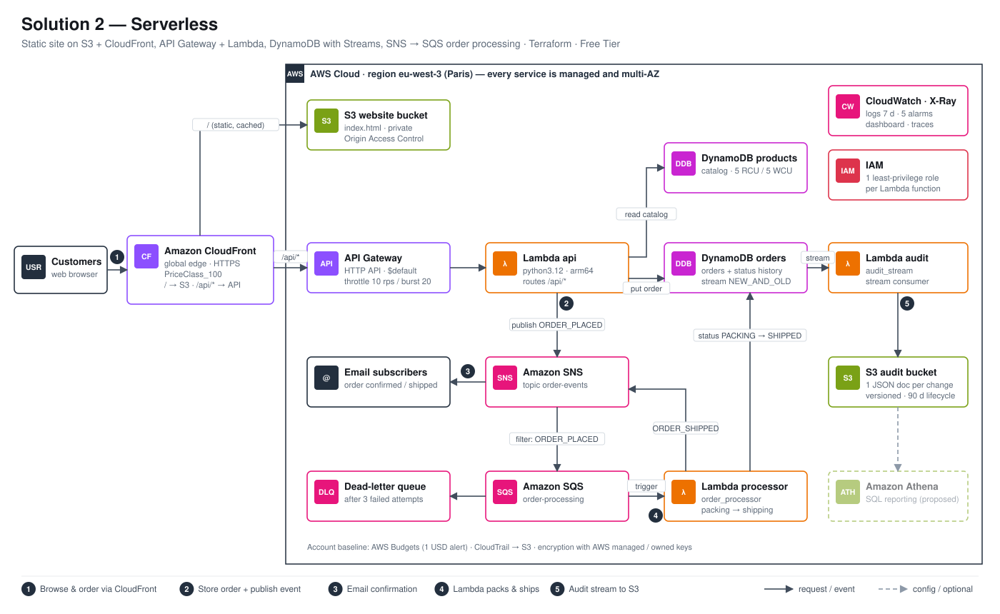

# FISA Shop — AWS Project 2026

Online vinyl record shop ("FISA Records") where customers browse a catalog, place orders and get a real-time
confirmation. Orders are recorded for audit and trigger internal processing
(packing, shipping simulation). Two implementations of the same functional
scope are provided, both fully automated with Terraform and sized for the AWS
Free Tier.

```
.
├── docs/                      # Architecture diagrams (SVG + PNG, generate_diagrams.py)
├── shared/                    # Used by both solutions
│   ├── catalog.json           #   product catalog (seed data, incl. image keys)
│   ├── images/                #   product images uploaded to the images S3 bucket
│   │   ├── covers/            #     album covers (one per product)
│   │   └── generate_covers.py #     regenerates the placeholder SVG covers
│   └── frontend/              #   Vite storefront (calls /api/*, loads /images/*)
├── 00-account-baseline/       # Budget alerts + CloudTrail (deploy once)
├── 01-solution-ec2/           # Solution 1: VMs (ALB + Auto Scaling + RDS)
│   ├── app/                   #   Flask API + SQS worker (Python)
│   ├── templates/             #   EC2 user data
│   └── tests/                 #   test.sh, failover.sh
└── 02-solution-serverless/    # Solution 2: CloudFront + API Gateway + Lambda + DynamoDB
    ├── lambda/                #   api, order_processor, audit_stream
    └── tests/                 #   test.sh
```

Both solutions expose the same API, so the same frontend and test scenarios work on both:

| Method | Path                | Purpose                                   |
|--------|---------------------|-------------------------------------------|
| GET    | `/api/health`       | Which backend / instance / AZ answered    |
| GET    | `/api/products`     | Catalog                                   |
| POST   | `/api/orders`       | Place an order (one or more products)     |
| GET    | `/api/orders/{id}`  | Order status + full history (audit)       |
| GET    | `/images/{key}`     | Product image from the images S3 bucket   |

Product images are stored in a private S3 bucket (`images/covers/*`, key =
the product's `image` field). Solution 2 serves them through a CloudFront
`/images/*` behavior (OAC); solution 1 answers `/images/*` with a redirect to
a short-lived presigned S3 URL.

### Frontend (Vite)

```bash
cd shared/frontend
npm ci
npm run dev                                   # local mock API, no AWS needed
SHOP_BACKEND=$(terraform -chdir=../../02-solution-serverless output -raw base_url) npm run dev   # against a deployed stack
npm run build                                 # writes dist/, required before terraform apply
```

## Event flow (common to both solutions)



SNS message filtering keeps `ORDER_SHIPPED` events out of the processing queue,
failed messages are retried 3 times and then moved to a dead-letter queue
(which triggers a CloudWatch alarm).

## Solution 1 — EC2 (virtual machines)



<details><summary>Mermaid version</summary>



</details>

* **High availability**: Auto Scaling group (min 1, max 2) spread over 2 AZs
  behind an ALB, ELB health checks on `/api/health` (unhealthy instances are
  replaced automatically), CPU target-tracking scaling (60 %), rolling instance
  refresh when the code changes. For an instance in each AZ at all times, deploy
  with `-var asg_min_size=2`.
* **Security**: RDS in private subnets with no Internet route; security groups
  chain ALB → app (8080) → DB (3306); IMDSv2 only; encrypted EBS and RDS; DB
  password generated by Terraform and stored as an SSM SecureString; no SSH
  key — shell access through SSM Session Manager.
* **Free Tier choices**: no NAT Gateway (instances use public IPs, inbound
  locked to the ALB), single-AZ RDS (`db_multi_az = false`), gp2 20 GB.

## Solution 2 — Serverless



<details><summary>Mermaid version</summary>

```mermaid
flowchart LR
    U((Users)) -->|HTTPS| CF[CloudFront]
    CF -->|/ (OAC)| S3W[(S3 website<br/>private)]
    CF -->|/api/*| APIGW[API Gateway HTTP API<br/>throttled]
    APIGW --> L1[Lambda api]
    L1 --> PT[(DynamoDB products)]
    L1 --> OT[(DynamoDB orders)]
    L1 -->|publish| SNS[SNS order-events]
    SNS --> SQS[SQS + DLQ] --> L2[Lambda order_processor] --> OT
    SNS --> Mail[Email]
    OT -->|DynamoDB Stream| L3[Lambda audit_stream] --> S3A[(S3 audit<br/>versioned, 90 d lifecycle)]
```

</details>

* **High availability by design**: every service is regional/multi-AZ or global
  (CloudFront), scales to zero, nothing to patch.
* **Streaming**: DynamoDB Streams → Lambda replaces Kafka/MSK at zero cost; the
  audit bucket is partitioned by date (`orders/dt=YYYY-MM-DD/…`) so it can be
  queried with Athena for reporting.
* **Security**: private S3 bucket reachable only through CloudFront Origin
  Access Control; one least-privilege IAM role per Lambda; API throttling
  (10 req/s, burst 20); X-Ray tracing; HTTPS only.
* **Free Tier choices**: DynamoDB in provisioned mode (2 × 5 RCU/WCU ≤ 25
  always free), arm64 Lambdas with 128 MB, CloudFront `PriceClass_100`,
  7-day log retention, AWS managed/owned encryption keys.

## Prerequisites

* Terraform ≥ 1.6, AWS CLI v2, `jq`, `curl`
* Node.js ≥ 20 (builds the Vite frontend)
* AWS credentials with permission to create the resources (`aws sts get-caller-identity`)
* Default region: `eu-west-3` (Paris) — override with `-var region=…`

## Deploy

Each folder is an independent Terraform root module with its own local state.
Both solutions upload the frontend from `shared/frontend/dist`, so build it
first (`cd shared/frontend && npm ci && npm run build`); `terraform apply`
stops with an explicit error if it is missing.
Copy `terraform.tfvars.example` to `terraform.tfvars` in each folder and set
your email to receive the notifications (optional for the solutions).

```bash
# 0. Account guardrails (once): 1 USD budget alerts + CloudTrail
cd 00-account-baseline
terraform init
terraform apply -var alert_email=you@example.com
```

```bash
# 1. Solution EC2 (~10 min, RDS creation is the longest step)
cd 01-solution-ec2
terraform init
terraform apply
terraform output base_url
```

```bash
# 2. Solution Serverless (~5 min, CloudFront distribution)
cd 02-solution-serverless
terraform init
terraform apply
terraform output base_url
```

Confirm the SNS subscription emails ("AWS Notification - Subscription
Confirmation") to receive order confirmations and alarms.

On the EC2 solution, the instances need 3–5 minutes after `apply` to install
the application and pass the ALB health checks; until then the ALB returns 502/503.

## Test scenarios

Open `base_url` in a browser: add products, place an order, and watch the status
timeline go `PENDING → PACKING → SHIPPED`. The header shows which backend
(instance + AZ for EC2) served the page.

Automated scenarios:

```bash
./01-solution-ec2/tests/test.sh           # load balancing, catalog, order, async processing
./01-solution-ec2/tests/failover.sh       # terminate an instance, ASG replaces it (deploy with -var asg_min_size=2 to keep the site up meanwhile)
./02-solution-serverless/tests/test.sh    # catalog, order, async processing, S3 audit trail, validation
```

Useful checks during the demo:

```bash
# Audit trail (serverless): one JSON document per order change
aws s3 ls s3://$(terraform -chdir=02-solution-serverless output -raw audit_bucket)/orders/ --recursive
```

```bash
# Worker logs on an EC2 instance (no SSH, through Session Manager)
aws ssm start-session --target <instance-id>
sudo journalctl -u shop-worker -f
```

CloudWatch dashboards are printed by `terraform output dashboard_url`.

## Cost and Free Tier

| Service | Usage | Free Tier coverage |
|---|---|---|
| EC2 t3.micro × 1–2 | ASG min 1 / max 2 | 750 h/month covers 1 instance full time; the 2nd one only runs under load (or with `asg_min_size=2`) |
| ALB | 1 ALB | 750 h + 15 LCU/month (12-month legacy Free Tier). **Its public IPv4 addresses are billed** (~0.005 USD/h each ≈ 0.25 USD/day) |
| RDS MySQL db.t4g.micro | single-AZ, 20 GB gp2 | 750 h/month + 20 GB (12 months) |
| Lambda | 3 functions, arm64 128 MB | 1 M requests + 400 000 GB-s/month (always free) |
| API Gateway HTTP API | | 1 M calls/month (12 months) |
| DynamoDB | 2 tables × 5 RCU/WCU, Streams | 25 RCU/WCU + 25 GB + 2.5 M stream reads (always free) |
| CloudFront | | 1 TB + 10 M requests/month (always free) |
| S3 | artifacts, website, audit, trail | 5 GB (12 months) |
| SNS / SQS | | 1 M publishes / 1 M requests (always free) |
| CloudWatch | 10 alarms, 3 dashboards, logs 7 days | 10 alarms + 3 dashboards + 5 GB logs |
| CloudTrail | 1 trail, management events | first copy free |
| KMS | AWS managed keys only | no monthly key fee |
| SSM Parameter Store | standard SecureString | free |

Accounts created after 15 July 2025 use the new Free Tier (credits up to
200 USD for 6 months) instead of the 12-month offers; the setup stays well
within those credits. In every case, **destroy the stacks after the demo**:

```bash
terraform -chdir=01-solution-ec2 destroy
terraform -chdir=02-solution-serverless destroy
```

## Not implemented (cost) — proposed alternatives

| Need | Implemented (free) | Production alternative (paid) |
|---|---|---|
| Streaming | DynamoDB Streams → Lambda | Amazon MSK / MSK Serverless (Kafka) or Kinesis Data Streams → Firehose → S3 |
| Private instances | public subnets + SG | private subnets + NAT Gateway or VPC endpoints |
| Database HA | single-AZ RDS | RDS Multi-AZ / Aurora Serverless v2 |
| Secrets | SSM SecureString | Secrets Manager with automatic rotation |
| Custom domain + TLS on ALB | default DNS names | Route 53 hosted zone + ACM certificate |
| Edge protection | API throttling | AWS WAF on CloudFront / ALB, Shield Advanced |
| Customer emails | SNS topic subscription | Amazon SES transactional emails per customer |
| Order workflow | worker with sleeps | Step Functions (packing → shipping → invoicing) |
| Users / accounts | anonymous orders | Amazon Cognito user pools |
| Containers | EC2 + systemd | ECS Fargate or EKS |
