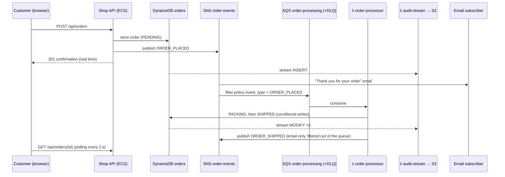

# FISA Shop — AWS Project 2026

Online vinyl record shop ("FISA Records") where customers browse a catalog,
place orders and get a real-time confirmation. Orders are recorded for audit
and trigger internal processing (packing, shipping simulation).

One infrastructure, fully automated with Terraform and sized for the AWS Free
Tier, combining **containers on EC2 (ECS)** for the request/response API and
**Lambda** for event-driven work:

| Runs on | What | Why |
|---|---|---|
| **ECS on EC2** (Express, Node.js) | Shop API: catalog, place order, track order | Answers users, always on, horizontal scaling behind an ALB |
| **Lambda** (Node.js) | Order processing (SQS), audit trail (DynamoDB Stream) | Triggered by events, bursty, no idle cost |
| **S3 + CloudFront** | Storefront (Vite) and product images | Static content at the edge, single HTTPS entry point |
| **DynamoDB** | Products and orders (+ stream) | Serverless, always-free 25 RCU/WCU |

Both the API and the Lambdas use the same code for the order domain
(`backend/lib/`): order status changes are DynamoDB conditional writes
(`PENDING → PACKING → SHIPPED`, `CANCELLED` from `PENDING`/`PACKING`), so any
writer is safe, which is the base for future features such as order
cancellation or a back office.

```
.
├── frontend/                 # Vite storefront (calls /api/*, loads /images/*)
├── images/                   # Product images uploaded to the images S3 bucket
│   ├── covers/               #   album covers (one per product)
│   └── generate_covers.py    #   regenerates the placeholder SVG covers
├── data/catalog.json         # Product catalog (seeded into DynamoDB by Terraform)
├── backend/
│   ├── lib/                  #   shared order domain + AWS clients
│   ├── api/                  #   Express shop API (ECS service), Dockerfile in backend/
│   ├── functions/            #   Lambdas: order-processor, audit-stream
│   └── test/                 #   unit tests (AWS clients stubbed)
├── infra/                    # Single Terraform root module
│   ├── baseline.tf           #   budget alerts + CloudTrail
│   ├── network.tf            #   VPC, 2 public subnets
│   ├── alb.tf, ecs.tf, ecr.tf#   ALB, ECS cluster/capacity provider/service, image build
│   ├── lambda.tf             #   Lambda functions + triggers
│   ├── dynamodb.tf, messaging.tf, storage.tf, cdn.tf, monitoring.tf
├── tests/                    # test.sh (end to end), failover.sh
└── docs/                     # Diagrams of the previous two-solution design (kept for comparison)
```

## API

| Method | Path                | Purpose                                   |
|--------|---------------------|-------------------------------------------|
| GET    | `/api/health`       | Which ECS task / AZ answered               |
| GET    | `/api/products`     | Catalog                                   |
| POST   | `/api/orders`       | Place an order (one or more products)     |
| GET    | `/api/orders/{id}`  | Order status + full history (audit)       |
| GET    | `/images/{key}`     | Product image (CloudFront → images S3 bucket) |

## Architecture

```mermaid
flowchart LR
    U((Users)) -->|HTTPS| CF[CloudFront]
    CF -->|/ OAC| S3W[(S3 website)]
    CF -->|/images/* OAC| S3I[(S3 images)]
    CF -->|/api/*| ALB[ALB<br/>CloudFront prefix list only]
    subgraph VPC 10.10.0.0/16 — 2 AZs, public subnets
      ALB --> T1[ECS task<br/>Express API]
      ALB --> T2[ECS task<br/>Express API]
      T1 & T2 -.- EC2[ECS capacity provider<br/>ASG t3.micro 1–2]
    end
    ECR[(ECR)] -.->|image| T1 & T2
    T1 & T2 --> PT[(DynamoDB products)]
    T1 & T2 --> OT[(DynamoDB orders)]
    T1 & T2 -->|publish| SNS[SNS order-events]
    SNS --> SQS[SQS + DLQ] --> L1[λ order-processor] --> OT
    L1 -->|ORDER_SHIPPED| SNS
    SNS --> Mail[Email]
    OT -->|DynamoDB Stream| L2[λ audit-stream] --> S3A[(S3 audit<br/>versioned, 90 d)]
```

### Event flow



SNS message filtering keeps `ORDER_SHIPPED` events out of the processing queue,
failed messages are retried 3 times and then moved to a dead-letter queue
(which triggers a CloudWatch alarm).

* **High availability**: 2 API tasks behind the ALB (health checks on
  `/api/health`, replaced automatically, deployment circuit breaker with
  rollback); tasks spread across AZs when 2 instances run
  (`-var asg_min_size=2`); task auto scaling on CPU (60 %) and the ECS capacity
  provider adds an instance when tasks no longer fit. DynamoDB, SQS, SNS,
  Lambda, S3 and CloudFront are multi-AZ or global by design.
* **Streaming**: DynamoDB Streams → Lambda replaces Kafka/MSK at zero cost; the
  audit bucket is partitioned by date (`orders/dt=YYYY-MM-DD/…`) so it can be
  queried with Athena for reporting.
* **Security**: the ALB only accepts CloudFront (AWS managed prefix list) and
  container instances only accept the ALB; private S3 buckets behind
  CloudFront Origin Access Control; least-privilege IAM roles (one per Lambda,
  a task role for the API, separate from the instance and execution roles);
  IMDSv2 with hop limit 1 so containers cannot read the instance credentials;
  encrypted EBS, SQS, SNS; ECR image scanning; no SSH (Session Manager);
  CloudTrail on every API call.
* **Free Tier choices**: ECS on EC2 instead of Fargate (no Fargate free tier),
  no NAT Gateway (instances in public subnets, inbound locked to the ALB),
  provisioned DynamoDB capacity, Container Insights off, 7-day log retention.

## Prerequisites

* Terraform ≥ 1.6, AWS CLI v2, `jq`, `curl`
* Node.js ≥ 22 (frontend build, backend tests)
* Docker with `buildx` running (Terraform builds and pushes the API image to ECR)
* AWS credentials with permission to create the resources (`aws sts get-caller-identity`)
* Default region: `eu-west-3` (Paris) — override with `-var region=…`

## Deploy

```bash
# 1. Build the storefront (Terraform uploads frontend/dist)
cd frontend && npm ci && npm run build && cd ..

# 2. Deploy everything (~5–10 min, CloudFront is the longest step)
cp infra/terraform.tfvars.example infra/terraform.tfvars   # set your email
terraform -chdir=infra init
terraform -chdir=infra apply
terraform -chdir=infra output base_url
```

`terraform apply` stops with an explicit error if `frontend/dist` is missing.
Confirm the SNS subscription emails ("AWS Notification - Subscription
Confirmation") to receive order confirmations and alarms. After the first
apply, the container instance needs 2–3 minutes to join the cluster and start
the tasks; until then `/api/*` returns 502/503.

## Develop

```bash
cd frontend
npm run dev                                                          # mock API, no AWS needed
SHOP_BACKEND=$(terraform -chdir=../infra output -raw base_url) npm run dev   # against the deployed stack

cd backend
npm ci && npm test                                                   # API + Lambdas with AWS clients stubbed
```

## Test scenarios

Open `base_url` in a browser: add records, place an order, and watch the status
timeline go `PENDING → PACKING → SHIPPED`. The footer shows which ECS task and
AZ answered.

```bash
./tests/test.sh       # load balancing, catalog + image, order, async processing, S3 audit trail, validation
./tests/failover.sh   # stop an API task: the ALB keeps serving and ECS starts a replacement
```

Useful checks during the demo:

```bash
# Audit trail: one JSON document per order change
aws s3 ls s3://$(terraform -chdir=infra output -raw audit_bucket)/orders/ --recursive

# API logs (ECS) and processor logs (Lambda)
aws logs tail /ecs/fisa-shop/shop-api --follow
aws logs tail /aws/lambda/fisa-shop-order-processor --follow
```

CloudWatch dashboard: `terraform -chdir=infra output dashboard_url`.

## Cost and Free Tier

| Service | Usage | Free Tier coverage |
|---|---|---|
| EC2 t3.micro × 1–2 (ECS container instances) | ASG min 1 / max 2, 30 GB gp3 | 750 h/month covers 1 instance full time; the 2nd one only runs when tasks no longer fit (or with `asg_min_size=2`) |
| ECS | cluster, service, capacity provider | no charge on EC2 |
| ECR | 1 repository, last 5 images | 500 MB/month (12 months) |
| ALB | 1 ALB | 750 h + 15 LCU/month (12-month legacy Free Tier). **Its public IPv4 addresses are billed** (~0.005 USD/h each ≈ 0.25 USD/day) |
| Lambda | 2 functions, arm64 128 MB | 1 M requests + 400 000 GB-s/month (always free) |
| DynamoDB | 2 tables × 5 RCU/WCU, Streams | 25 RCU/WCU + 25 GB + 2.5 M stream reads (always free) |
| CloudFront | | 1 TB + 10 M requests/month (always free) |
| S3 | website, images, audit, trail | 5 GB (12 months) |
| SNS / SQS | | 1 M publishes / 1 M requests (always free) |
| CloudWatch | 6 alarms, 1 dashboard, logs 7 days | 10 alarms + 3 dashboards + 5 GB logs |
| CloudTrail | 1 trail, management events | first copy free |
| Budgets | 1 budget | first 2 free |
| KMS | AWS managed keys only | no monthly key fee |

Accounts created after 15 July 2025 use the new Free Tier (credits up to
200 USD for 6 months) instead of the 12-month offers; the setup stays well
within those credits. **Destroy the stack after the demo**:

```bash
terraform -chdir=infra destroy
```

## Not implemented (cost) — proposed alternatives

| Need | Implemented (free) | Production alternative (paid) |
|---|---|---|
| Streaming | DynamoDB Streams → Lambda | Amazon MSK / MSK Serverless (Kafka) or Kinesis Data Streams → Firehose → S3 |
| Private container instances | public subnets + SG (inbound from ALB only) | private subnets + NAT Gateway or VPC endpoints |
| Database | DynamoDB provisioned 5 RCU/WCU | on-demand capacity, global tables, PITR backups |
| Custom domain + TLS CloudFront → ALB | default DNS names, HTTP between CloudFront and ALB | Route 53 hosted zone + ACM certificates |
| Edge protection | ALB reachable from CloudFront only | AWS WAF on CloudFront, Shield Advanced |
| Customer emails | SNS topic subscription | Amazon SES transactional emails per customer |
| Order workflow | Lambda with sleeps | Step Functions (packing → shipping → invoicing) |
| Users / accounts | anonymous orders | Amazon Cognito user pools |
| Container capacity | ECS on EC2 t3.micro (capacity provider) | ECS Fargate (no instances to manage) or EKS |
